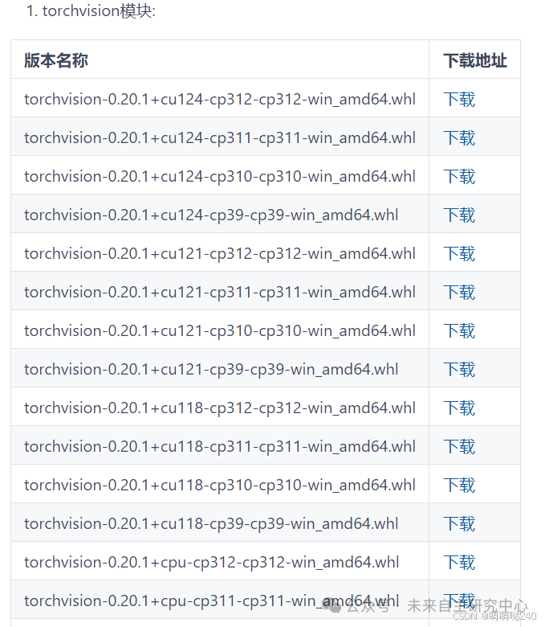

# [python] Install torchvision, torchaudio and other WHL files through the whl file

To install `torchvision` and `torchaudio` through the `.whl` file, you first need to ensure that you have PyTorch compatible versions installed. Here is a detailed step-by-step guide to help you install these libraries using the `.whl` file.

#### 1. Install PyTorch

First, make sure you have installed PyTorch. You can get the installation command suitable for your system from the official website of PyTorch.

For example, if you are using CUDA 11.3 and Python 3.8, you can install PyTorch with the following command:

```
pip install torch torchvision torchaudio --index-url https://pytorch.org/get-started/locally/

-

1

```

However, if you need to manually install the `.whl` files, you first need to download these files.

2. Download the `.whl` file

1.

Visit the PyTorch download page, and generally, official WHL files are over 2GB in size. Therefore, there is currently no server storage available, and you can only download from the official address. Torchvision and TorchAudio can be accessed through the domestic mirror: gitee.com/FIRC/torchvision_torchaudio_chinese_mirror.

1.

Select the option that is suitable for your system (operating system, package manager, Python version, CUDA version, etc.).

1.

Download the `.whl` files for PyTorch, torchvision, and torchaudio (these are too large to download directly from China).

1.



#### 3. Install the `.whl` file

Use `pip` to install the downloaded `.whl` files. Assuming you have downloaded these files to the current directory, you can use the following command to install:

```
pip install torch-<version>-<platform>.whl
pip install torchvision-<version>-<platform>.whl
pip install torchaudio-<version>-<platform>.whl

-

1

-

2

-

3

```

Please replace `<version>` and `<platform>` with the actual file name parts. For example, if your filenames are `torch-1.9.0+cu111.whl`, `torchvision-0.10.0+cu111.whl`, and `torchaudio-0.9.0-cp38-cp38-linux_x86_64.whl`, then the command would be:

```
pip install torch-1.9.0+cu111.whl
pip install torchvision-0.10.0+cu111.whl
pip install torchaudio-0.9.0-cp38-cp38-linux_x86_64.whl

-

1

-

2

-

3

```

4. Verification Installation

You can verify if the installation is successful by running the following Python code:

```
import torch
import torchvision
import torchaudio
print(torch.__version__)
print(torchvision.__version__)
print(torchaudio.__version__)

-

1

-

2

-

3

-

4

-

5

-

6

-

7

```

If the output shows the correct version number, then it means the installation was successful.

#### Notes

1.

Dependency: Ensure that your Python version and any dependencies (such as CUDA) are compatible with the `.whl` file.

1.

Permissions: On some systems, you may need to use `sudo` to install `.whl` files, for example, `sudo pip install torch-<version>-<platform>.whl`.

1.

Environment: Ensure that you run the installation command in the activated virtual environment, if you are using a virtual environment (such as `conda` or `venv`).

Following these steps, you should be able to successfully install `torchvision` and `torchaudio` through the `.whl` file.

The following is a summary of the torchvision versions:
torchvision-0.20.1+cu124-cp312-cp312-win_amd64.whl
torchvision-0.20.1+cu124-cp311-cp311-win_amd64.whl
torchvision-0.20.1+cu124-cp310-cp310-win_amd64.whl
torchvision-0.20.1+cu124-cp39-cp39-win_amd64.whl
torchvision-0.20.1+cu121-cp312-cp312-win_amd64.whl
torchvision-0.20.1+cu121-cp311-cp311-win_amd64.whl
torchvision-0.20.1+cu121-cp310-cp310-win_amd64.whl
torchvision-0.20.1+cu121-cp39-cp39-win_amd64.whl
torchvision-0.20.1+cu118-cp312-cp312-win_amd64.whl
torchvision-0.20.1+cu118-cp311-cp311-win_amd64.whl
torchvision-0.20.1+cu118-cp310-cp310-win_amd64.whl
torchvision-0.20.1+cu118-cp39-cp39-win_amd64.whl
torchvision-0.20.1+cpu-cp312-cp312-win_amd64.whl
torchvision-0.20.1+cpu-cp311-cp311-win_amd64.whl
torchvision-0.20.1+cpu-cp310-cp310-win_amd64.whl
torchvision-0.20.1+cpu-cp39-cp39-win_amd64.whl
torchvision-0.20.0+cu124-cp312-cp312-win_amd64.whl
torchvision-0.20.0+cu124-cp311-cp311-win_amd64.whl
torchvision-0.20.0+cu124-cp310-cp310-win_amd64.whl
torchvision-0.20.0+cu124-cp39-cp39-win_amd64.whl
torchvision-0.20.0+cu121-cp312-cp312-win_amd64.whl
torchvision-0.20.0+cu121-cp311-cp311-win_amd64.whl
torchvision-0.20.0+cu121-cp310-cp310-win_amd64.whl
torchvision-0.20.0+cu121-cp39-cp39-win_amd64.whl
torchvision-0.20.0+cu118-cp312-cp312-win_amd64.whl
torchvision-0.20.0+cu118-cp311-cp311-win_amd64.whl
torchvision-0.20.0+cu118-cp310-cp310-win_amd64.whl
torchvision-0.20.0+cu118-cp39-cp39-win_amd64.whl
torchvision-0.20.0+cpu-cp312-cp312-win_amd64.whl
torchvision-0.20.0+cpu-cp311-cp311-win_amd64.whl
torchvision-0.20.0+cpu-cp310-cp310-win_amd64.whl
torchvision-0.20.0+cpu-cp39-cp39-win_amd64.whl
torchvision-0.19.1+cu124-cp312-cp312-win_amd64.whl
torchvision-0.19.1+cu124-cp311-cp311-win_amd64.whl
torchvision-0.19.1+cu124-cp310-cp310-win_amd64.whl
torchvision-0.19.1+cu124-cp39-cp39-win_amd64.whl
torchvision-0.19.1+cu124-cp38-cp38-win_amd64.whl
torchvision-0.19.1+cu121-cp312-cp312-win_amd64.whl
torchvision-0.19.1+cu121-cp311-cp311-win_amd64.whl
torchvision-0.19.1+cu121-cp310-cp310-win_amd64.whl
torchvision-0.19.1+cu121-cp39-cp39-win_amd64.whl
torchvision-0.19.1+cu121-cp38-cp38-win_amd64.whl
torchvision-0.19.1+cu118-cp312-cp312-win_amd64.whl
torchvision-0.19.1+cu118-cp311-cp311-win_amd64.whl
torchvision-0.19.1+cu118-cp310-cp310-win_amd64.whl
torchvision-0.19.1+cu118-cp39-cp39-win_amd64.whl
torchvision-0.19.1+cu118-cp38-cp38-win_amd64.whl
torchvision-0.19.1+cpu-cp312-cp312-win_amd64.whl
torchvision-0.19.1+cpu-cp311-cp311-win_amd64.whl
torchvision-0.19.1+cpu-cp310-cp310-win_amd64.whl
torchvision-0.19.1+cpu-cp39-cp39-win_amd64.whl
torchvision-0.19.1+cpu-cp38-cp38-win_amd64.whl
torchvision-0.19.0+cu124-cp312-cp312-win_amd64.whl
torchvision-0.19.0+cu124-cp311-cp311-win_amd64.whl
torchvision-0.19.0+cu124-cp310-cp310-win_amd64.whl
torchvision-0.19.0+cu124-cp39-cp39-win_amd64.whl
torchvision-0.19.0+cu121-cp312-cp312-win_amd64.whl
torchvision-0.19.0+cu121-cp311-cp311-win_amd64.whl
torchvision-0.19.0+cu121-cp310-cp310-win_amd64.whl
torchvision-0.19.0+cu121-cp39-cp39-win_amd64.whl
torchvision-0.19.0+cu121-cp38-cp38-win_amd64.whl
torchvision-0.19.0+cu118-cp312-cp312-win_amd64.whl
torchvision-0.19.0+cu118-cp311-cp311-win_amd64.whl
torchvision-0.19.0+cu118-cp310-cp310-win_amd64.whl
torchvision-0.19.0+cu118-cp39-cp39-win_amd64.whl
torchvision-0.19.0+cu118-cp38-cp38-win_amd64.whl
torchvision-0.19.0+cpu-cp312-cp312-win_amd64.whl
torchvision-0.19.0+cpu-cp311-cp311-win_amd64.whl
torchvision-0.19.0+cpu-cp310-cp310-win_amd64.whl
torchvision-0.19.0+cpu-cp39-cp39-win_amd64.whl
torchvision-0.19.0+cpu-cp38-cp38-win_amd64.whl
torchvision-0.18.1+cu121-cp312-cp312-win_amd64.whl
torchvision-0.18.1+cu121-cp311-cp311-win_amd64.whl
torchvision-0.18.1+cu121-cp310-cp310-win_amd64.whl
torchvision-0.18.1+cu121-cp39-cp39-win_amd64.whl
torchvision-0.18.1+cu121-cp38-cp38-win_amd64.whl
torchvision-0.18.1+cu118-cp312-cp312-win_amd64.whl
torchvision-0.18.1+cu118-cp311-cp311-win_amd64.whl
torchvision-0.18.1+cu118-cp310-cp310-win_amd64.whl
torchvision-0.18.1+cu118-cp39-cp39-win_amd64.whl
torchvision-0.18.1+cu118-cp38-cp38-win_amd64.whl
torchvision-0.18.1+cpu-cp312-cp312-win_amd64.whl
torchvision-0.18.1+cpu-cp311-cp311-win_amd64.whl
torchvision-0.18.1+cpu-cp310-cp310-win_amd64.whl
torchvision-0.18.1+cpu-cp39-cp39-win_amd64.whl
torchvision-0.18.1+cpu-cp38-cp38-win_amd64.whl
torchvision-0.18.0+cu121-cp312-cp312-win_amd64.whl
torchvision-0.18.0+cu121-cp311-cp311-win_amd64.whl
torchvision-0.18.0+cu121-cp310-cp310-win_amd64.whl
torchvision-0.18.0+cu121-cp39-cp39-win_amd64.whl
torchvision-0.18.0+cu121-cp38-cp38-win_amd64.whl
torchvision-0.18.0+cu118-cp312-cp312-win_amd64.whl
torchvision-0.18.0+cu118-cp311-cp311-win_amd64.whl
torchvision-0.18.0+cu118-cp310-cp310-win_amd64.whl
torchvision-0.18.0+cu118-cp39-cp39-win_amd64.whl
torchvision-0.18.0+cu118-cp38-cp38-win_amd64.whl
torchvision-0.18.0+cpu-cp312-cp312-win_amd64.whl
torchvision-0.18.0+cpu-cp311-cp311-win_amd64.whl
torchvision-0.18.0+cpu-cp310-cp310-win_amd64.whl
torchvision-0.18.0+cpu-cp39-cp39-win_amd64.whl
torchvision-0.18.0+cpu-cp38-cp38-win_amd64.whl
torchvision-0.17.2+cu121-cp312-cp312-win_amd64.whl
torchvision-0.17.2+cu121-cp311-cp311-win_amd64.whl
torchvision-0.17.2+cu121-cp310-cp310-win_amd64.whl
torchvision-0.17.2+cu121-cp39-cp39-win_amd64.whl
torchvision-0.17.2+cu121-cp38-cp38-win_amd64.whl
torchvision-0.17.2+cu118-cp312-cp312-win_amd64.whl
torchvision-0.17.2+cu118-cp311-cp311-win_amd64.whl
torchvision-0.17.2+cu118-cp310-cp310-win_amd64.whl
torchvision-0.17.2+cu118-cp39-cp39-win_amd64.whl
torchvision-0.17.2+cu118-cp38-cp38-win_amd64.whl
torchvision-0.17.2+cpu-cp312-cp312-win_amd64.whl
torchvision-0.17.2+cpu-cp311-cp311-win_amd64.whl
torchvision-0.17.2+cpu-cp310-cp310-win_amd64.whl
torchvision-0.17.2+cpu-cp39-cp39-win_amd64.whl
torchvision-0.17.2+cpu-cp38-cp38-win_amd64.whl
torchvision-0.17.1+cu121-cp312-cp312-win_amd64.whl
torchvision-0.17.1+cu121-cp311-cp311-win_amd64.whl
torchvision-0.17.1+cu121-cp310-cp310-win_amd64.whl
torchvision-0.17.1+cu121-cp39-cp39-win_amd64.whl
torchvision-0.17.1+cu121-cp38-cp38-win_amd64.whl
torchvision-0.17.1+cu118-cp312-cp312-win_amd64.whl
torchvision-0.17.1+cu118-cp311-cp311-win_amd64.whl
torchvision-0.17.1+cu118-cp310-cp310-win_amd64.whl
torchvision-0.17.1+cu118-cp39-cp39-win_amd64.whl
torchvision-0.17.1+cu118-cp38-cp38-win_amd64.whl
torchvision-0.17.1+cpu-cp312-cp312-win_amd64.whl
torchvision-0.17.1+cpu-cp311-cp311-win_amd64.whl
torchvision-0.17.1+cpu-cp310-cp310-win_amd64.whl
torchvision-0.17.1+cpu-cp39-cp39-win_amd64.whl
torchvision-0.17.1+cpu-cp38-cp38-win_amd64.whl
torchvision-0.17.0+cu121-cp312-cp312-win_amd64.whl
torchvision-0.17.0+cu121-cp311-cp311-win_amd64.whl
torchvision-0.17.0+cu121-cp310-cp310-win_amd64.whl
torchvision-0.17.0+cu121-cp39-cp39-win_amd64.whl
torchvision-0.17.0+cu121-cp38-cp38-win_amd64.whl
torchvision-0.17.0+cu118-cp312-cp312-win_amd64.whl
torchvision-0.17.0+cu118-cp311-cp311-win_amd64.whl
torchvision-0.17.0+cu118-cp310-cp310-win_amd64.whl
torchvision-0.17.0+cu118-cp39-cp39-win_amd64.whl
torchvision-0.17.0+cu118-cp38-cp38-win_amd64.whl
torchvision-0.17.0+cpu-cp312-cp312-win_amd64.whl
torchvision-0.17.0+cpu-cp311-cp311-win_amd64.whl
torchvision-0.17.0+cpu-cp310-cp310-win_amd64.whl
torchvision-0.17.0+cpu-cp39-cp39-win_amd64.whl
torchvision-0.17.0+cpu-cp38-cp38-win_amd64.whl
torchvision-0.16.2+cu121-cp311-cp311-win_amd64.whl
torchvision-0.16.2+cu121-cp310-cp310-win_amd64.whl
torchvision-0.16.2+cu121-cp39-cp39-win_amd64.whl
torchvision-0.16.2+cu121-cp38-cp38-win_amd64.whl
torchvision-0.16.2+cu118-cp311-cp311-win_amd64.whl
torchvision-0.16.2+cu118-cp310-cp310-win_amd64.whl
torchvision-0.16.2+cu118-cp39-cp39-win_amd64.whl
torchvision-0.16.2+cu118-cp38-cp38-win_amd64.whl
torchvision-0.16.2+cpu-cp311-cp311-win_amd64.whl
torchvision-0.16.2+cpu-cp310-cp310-win_amd64.whl
torchvision-0.16.2+cpu-cp39-cp39-win_amd64.whl
torchvision-0.16.2+cpu-cp38-cp38-win_amd64.whl
torchvision-0.16.1+cu121-cp311-cp311-win_amd64.whl
torchvision-0.16.1+cu121-cp310-cp310-win_amd64.whl
torchvision-0.16.1+cu121-cp39-cp39-win_amd64.whl
torchvision-0.16.1+cu121-cp38-cp38-win_amd64.whl
torchvision-0.16.1+cu118-cp311-cp311-win_amd64.whl
torchvision-0.16.1+cu118-cp310-cp310-win_amd64.whl
torchvision-0.16.1+cu118-cp39-cp39-win_amd64.whl
torchvision-0.16.1+cu118-cp38-cp38-win_amd64.whl
torchvision-0.16.1+cpu-cp311-cp311-win_amd64.whl
torchvision-0.16.1+cpu-cp310-cp310-win_amd64.whl
torchvision-0.16.1+cpu-cp39-cp39-win_amd64.whl
torchvision-0.16.1+cpu-cp38-cp38-win_amd64.whl
torchvision-0.16.0+cu121-cp311-cp311-win_amd64.whl
torchvision-0.16.0+cu121-cp310-cp310-win_amd64.whl
torchvision-0.16.0+cu121-cp39-cp39-win_amd64.whl
torchvision-0.16.0+cu121-cp38-cp38-win_amd64.whl
torchvision-0.16.0+cu118-cp311-cp311-win_amd64.whl
torchvision-0.16.0+cu118-cp310-cp310-win_amd64.whl
torchvision-0.16.0+cu118-cp39-cp39-win_amd64.whl
torchvision-0.16.0+cu118-cp38-cp38-win_amd64.whl
torchvision-0.16.0+cpu-cp311-cp311-win_amd64.whl
torchvision-0.16.0+cpu-cp310-cp310-win_amd64.whl
torchvision-0.16.0+cpu-cp39-cp39-win_amd64.whl
torchvision-0.16.0+cpu-cp38-cp38-win_amd64.whl
torchvision-0.15.2+cu118-cp311-cp311-win_amd64.whl
torchvision-0.15.2+cu118-cp310-cp310-win_amd64.whl
torchvision-0.15.2+cu118-cp39-cp39-win_amd64.whl
torchvision-0.15.2+cu118-cp38-cp38-win_amd64.whl
torchvision-0.15.2+cu117-cp311-cp311-win_amd64.whl
torchvision-0.15.2+cu117-cp310-cp310-win_amd64.whl
torchvision-0.15.2+cu117-cp39-cp39-win_amd64.whl
torchvision-0.15.2+cu117-cp38-cp38-win_amd64.whl
torchvision-0.15.2+cpu-cp311-cp311-win_amd64.whl
torchvision-0.15.2+cpu-cp310-cp310-win_amd64.whl
torchvision-0.15.2+cpu-cp39-cp39-win_amd64.whl
torchvision-0.15.2+cpu-cp38-cp38-win_amd64.whl
torchvision-0.15.1+cu118-cp311-cp311-win_amd64.whl
torchvision-0.15.1+cu118-cp310-cp310-win_amd64.whl
torchvision-0.15.1+cu118-cp39-cp39-win_amd64.whl
torchvision-0.15.1+cu118-cp38-cp38-win_amd64.whl
torchvision-0.15.1+cu117-cp311-cp311-win_amd64.whl
torchvision-0.15.1+cu117-cp310-cp310-win_amd64.whl
torchvision-0.15.1+cu117-cp39-cp39-win_amd64.whl
torchvision-0.15.1+cu117-cp38-cp38-win_amd64.whl
torchvision-0.15.1+cpu-cp311-cp311-win_amd64.whl
torchvision-0.15.1+cpu-cp310-cp310-win_amd64.whl
torchvision-0.15.1+cpu-cp39-cp39-win_amd64.whl
torchvision-0.15.1+cpu-cp38-cp38-win_amd64.whl
torchvision-0.15.0+cu118-cp311-cp311-win_amd64.whl
torchvision-0.15.0+cu118-cp310-cp310-win_amd64.whl
torchvision-0.15.0+cu118-cp39-cp39-win_amd64.whl
torchvision-0.15.0+cu118-cp38-cp38-win_amd64.whl
torchvision-0.15.0+cu117-cp311-cp311-win_amd64.whl
torchvision-0.15.0+cu117-cp310-cp310-win_amd64.whl
torchvision-0.15.0+cu117-cp39-cp39-win_amd64.whl
torchvision-0.15.0+cu117-cp38-cp38-win_amd64.whl
torchvision-0.15.0+cpu-cp311-cp311-win_amd64.whl
torchvision-0.15.0+cpu-cp310-cp310-win_amd64.whl
torchvision-0.15.0+cpu-cp39-cp39-win_amd64.whl
torchvision-0.15.0+cpu-cp38-cp38-win_amd64.whl
torchvision-0.14.1+cu117-cp310-cp310-win_amd64.whl
torchvision-0.14.1+cu117-cp39-cp39-win_amd64.whl
torchvision-0.14.1+cu117-cp38-cp38-win_amd64.whl
torchvision-0.14.1+cu117-cp37-cp37m-win_amd64.whl
torchvision-0.14.1+cu116-cp310-cp310-win_amd64.whl
torchvision-0.14.1+cu116-cp39-cp39-win_amd64.whl
torchvision-0.14.1+cu116-cp38-cp38-win_amd64.whl
torchvision-0.14.1+cu116-cp37-cp37m-win_amd64.whl
torchvision-0.14.1+cpu-cp310-cp310-win_amd64.whl
torchvision-0.14.1+cpu-cp39-cp39-win_amd64.whl
torchvision-0.14.1+cpu-cp38-cp38-win_amd64.whl
torchvision-0.14.1+cpu-cp37-cp37m-win_amd64.whl
torchvision-0.14.0+cu117-cp310-cp310-win_amd64.whl
torchvision-0.14.0+cu117-cp39-cp39-win_amd64.whl
torchvision-0.14.0+cu117-cp38-cp38-win_amd64.whl
torchvision-0.14.0+cu117-cp37-cp37m-win_amd64.whl
torchvision-0.14.0+cu116-cp310-cp310-win_amd64.whl
torchvision-0.14.0+cu116-cp39-cp39-win_amd64.whl
torchvision-0.14.0+cu116-cp38-cp38-win_amd64.whl
torchvision-0.14.0+cu116-cp37-cp37m-win_amd64.whl
torchvision-0.14.0+cpu-cp310-cp310-win_amd64.whl
torchvision-0.14.0+cpu-cp39-cp39-win_amd64.whl
torchvision-0.14.0+cpu-cp38-cp38-win_amd64.whl
torchvision-0.14.0+cpu-cp37-cp37m-win_amd64.whl
torchvision-0.13.1+cu116-cp310-cp310-win_amd64.whl
torchvision-0.13.1+cu116-cp39-cp39-win_amd64.whl
torchvision-0.13.1+cu116-cp38-cp38-win_amd64.whl
torchvision-0.13.1+cu116-cp37-cp37m-win_amd64.whl
torchvision-0.13.1+cu113-cp310-cp310-win_amd64.whl
torchvision-0.13.1+cu113-cp39-cp39-win_amd64.whl
torchvision-0.13.1+cu113-cp38-cp38-win_amd64.whl
torchvision-0.13.1+cu113-cp37-cp37m-win_amd64.whl
torchvision-0.13.1+cpu-cp310-cp310-win_amd64.whl
torchvision-0.13.1+cpu-cp39-cp39-win_amd64.whl
torchvision-0.13.1+cpu-cp38-cp38-win_amd64.whl
torchvision-0.13.1+cpu-cp37-cp37m-win_amd64.whl
torchvision-0.13.0+cu116-cp310-cp310-win_amd64.whl
torchvision-0.13.0+cu116-cp39-cp39-win_amd64.whl
torchvision-0.13.0+cu116-cp38-cp38-win_amd64.whl
torchvision-0.13.0+cu116-cp37-cp37m-win_amd64.whl
torchvision-0.13.0+cu113-cp310-cp310-win_amd64.whl
torchvision-0.13.0+cu113-cp39-cp39-win_amd64.whl
torchvision-0.13.0+cu113-cp38-cp38-win_amd64.whl
torchvision-0.13.0+cu113-cp37-cp37m-win_amd64.whl
torchvision-0.13.0+cpu-cp310-cp310-win_amd64.whl
torchvision-0.13.0+cpu-cp39-cp39-win_amd64.whl
torchvision-0.13.0+cpu-cp38-cp38-win_amd64.whl
torchvision-0.13.0+cpu-cp37-cp37m-win_amd64.whl
torchvision-0.12.0+cu115-cp310-cp310-win_amd64.whl
torchvision-0.12.0+cu115-cp39-cp39-win_amd64.whl
torchvision-0.12.0+cu115-cp38-cp38-win_amd64.whl
torchvision-0.12.0+cu115-cp37-cp37m-win_amd64.whl
torchvision-0.12.0+cu113-cp310-cp310-win_amd64.whl
torchvision-0.12.0+cu113-cp39-cp39-win_amd64.whl
torchvision-0.12.0+cu113-cp38-cp38-win_amd64.whl
torchvision-0.12.0+cu113-cp37-cp37m-win_amd64.whl
torchvision-0.12.0+cpu-cp310-cp310-win_amd64.whl
torchvision-0.12.0+cpu-cp39-cp39-win_amd64.whl
torchvision-0.12.0+cpu-cp38-cp38-win_amd64.whl
torchvision-0.12.0+cpu-cp37-cp37m-win_amd64.whl
torchvision-0.11.3+cu113-cp39-cp39-win_amd64.whl
torchvision-0.11.3+cu113-cp38-cp38-win_amd64.whl
torchvision-0.11.3+cu113-cp37-cp37m-win_amd64.whl
torchvision-0.11.3+cu113-cp36-cp36m-win_amd64.whl
torchvision-0.11.3+cu102-cp39-cp39-win_amd64.whl
torchvision-0.11.3+cu102-cp38-cp38-win_amd64.whl
torchvision-0.11.3+cu102-cp37-cp37m-win_amd64.whl
torchvision-0.11.3+cu102-cp36-cp36m-win_amd64.whl
torchvision-0.11.3+cpu-cp39-cp39-win_amd64.whl
torchvision-0.11.3+cpu-cp38-cp38-win_amd64.whl
torchvision-0.11.3+cpu-cp37-cp37m-win_amd64.whl
torchvision-0.11.3+cpu-cp36-cp36m-win_amd64.whl
torchvision-0.11.2+cu113-cp39-cp39-win_amd64.whl
torchvision-0.11.2+cu113-cp38-cp38-win_amd64.whl
torchvision-0.11.2+cu113-cp37-cp37m-win_amd64.whl
torchvision-0.11.2+cu113-cp36-cp36m-win_amd64.whl
torchvision-0.11.2+cu102-cp39-cp39-win_amd64.whl
torchvision-0.11.2+cu102-cp38-cp38-win_amd64.whl
torchvision-0.11.2+cu102-cp37-cp37m-win_amd64.whl
torchvision-0.11.2+cu102-cp36-cp36m-win_amd64.whl
torchvision-0.11.2+cpu-cp39-cp39-win_amd64.whl
torchvision-0.11.2+cpu-cp38-cp38-win_amd64.whl
torchvision-0.11.2+cpu-cp37-cp37m-win_amd64.whl
torchvision-0.11.2+cpu-cp36-cp36m-win_amd64.whl
torchvision-0.11.1+cu113-cp39-cp39-win_amd64.whl
torchvision-0.11.1+cu113-cp38-cp38-win_amd64.whl
torchvision-0.11.1+cu113-cp37-cp37m-win_amd64.whl
torchvision-0.11.1+cu113-cp36-cp36m-win_amd64.whl
torchvision-0.11.1+cu102-cp39-cp39-win_amd64.whl
torchvision-0.11.1+cu102-cp38-cp38-win_amd64.whl
torchvision-0.11.1+cu102-cp37-cp37m-win_amd64.whl
torchvision-0.11.1+cu102-cp36-cp36m-win_amd64.whl
torchvision-0.11.1+cpu-cp39-cp39-win_amd64.whl
torchvision-0.11.1+cpu-cp38-cp38-win_amd64.whl
torchvision-0.11.1+cpu-cp37-cp37m-win_amd64.whl
torchvision-0.11.1+cpu-cp36-cp36m-win_amd64.whl
torchvision-0.11.0+cu113-cp39-cp39-win_amd64.whl
torchvision-0.11.0+cu113-cp38-cp38-win_amd64.whl
torchvision-0.11.0+cu113-cp37-cp37m-win_amd64.whl
torchvision-0.11.0+cu113-cp36-cp36m-win_amd64.whl
torchvision-0.11.0+cu102-cp39-cp39-win_amd64.whl
torchvision-0.11.0+cu102-cp38-cp38-win_amd64.whl
torchvision-0.11.0+cu102-cp37-cp37m-win_amd64.whl
torchvision-0.11.0+cu102-cp36-cp36m-win_amd64.whl
torchvision-0.11.0+cpu-cp39-cp39-win_amd64.whl
torchvision-0.11.0+cpu-cp38-cp38-win_amd64.whl
torchvision-0.11.0+cpu-cp37-cp37m-win_amd64.whl
torchvision-0.11.0+cpu-cp36-cp36m-win_amd64.whl
torchvision-0.10.1+cu111-cp39-cp39-win_amd64.whl
torchvision-0.10.1+cu111-cp38-cp38-win_amd64.whl
torchvision-0.10.1+cu111-cp37-cp37m-win_amd64.whl
torchvision-0.10.1+cu111-cp36-cp36m-win_amd64.whl
torchvision-0.10.1+cu102-cp39-cp39-win_amd64.whl
torchvision-0.10.1+cu102-cp38-cp38-win_amd64.whl
torchvision-0.10.1+cu102-cp37-cp37m-win_amd64.whl
torchvision-0.10.1+cu102-cp36-cp36m-win_amd64.whl
torchvision-0.10.1+cpu-cp39-cp39-win_amd64.whl
torchvision-0.10.1+cpu-cp38-cp38-win_amd64.whl
torchvision-0.10.1+cpu-cp37-cp37m-win_amd64.whl
torchvision-0.10.1+cpu-cp36-cp36m-win_amd64.whl
torchvision-0.10.0-cp39-cp39-win_amd64.whl
torchvision-0.10.0-cp38-cp38-win_amd64.whl
torchvision-0.10.0-cp37-cp37m-win_amd64.whl
torchvision-0.10.0-cp36-cp36m-win_amd64.whl
torchvision-0.10.0+cu111-cp39-cp39-win_amd64.whl
torchvision-0.10.0+cu111-cp38-cp38-win_amd64.whl
torchvision-0.10.0+cu111-cp37-cp37m-win_amd64.whl
torchvision-0.10.0+cu111-cp36-cp36m-win_amd64.whl
torchvision-0.10.0+cu102-cp39-cp39-win_amd64.whl
torchvision-0.10.0+cu102-cp38-cp38-win_amd64.whl
torchvision-0.10.0+cu102-cp37-cp37m-win_amd64.whl
torchvision-0.10.0+cu102-cp36-cp36m-win_amd64.whl
torchvision-0.10.0+cpu-cp39-cp39-win_amd64.whl
torchvision-0.10.0+cpu-cp38-cp38-win_amd64.whl
torchvision-0.10.0+cpu-cp37-cp37m-win_amd64.whl
torchvision-0.10.0+cpu-cp36-cp36m-win_amd64.whl
torchvision-0.9.1+cu111-cp39-cp39-win_amd64.whl
torchvision-0.9.1+cu111-cp38-cp38-win_amd64.whl
torchvision-0.9.1+cu111-cp37-cp37m-win_amd64.whl
torchvision-0.9.1+cu111-cp36-cp36m-win_amd64.whl
torchvision-0.9.1+cu102-cp39-cp39-win_amd64.whl
torchvision-0.9.1+cu102-cp38-cp38-win_amd64.whl
torchvision-0.9.1+cu102-cp37-cp37m-win_amd64.whl
torchvision-0.9.1+cu102-cp36-cp36m-win_amd64.whl
torchvision-0.9.1+cu101-cp39-cp39-win_amd64.whl
torchvision-0.9.1+cu101-cp38-cp38-win_amd64.whl
torchvision-0.9.1+cu101-cp37-cp37m-win_amd64.whl
torchvision-0.9.1+cu101-cp36-cp36m-win_amd64.whl
torchvision-0.9.1+cpu-cp39-cp39-win_amd64.whl
torchvision-0.9.1+cpu-cp38-cp38-win_amd64.whl
torchvision-0.9.1+cpu-cp37-cp37m-win_amd64.whl
torchvision-0.9.1+cpu-cp36-cp36m-win_amd64.whl
torchvision-0.9.0-cp39-cp39-win_amd64.whl
torchvision-0.9.0-cp38-cp38-win_amd64.whl
torchvision-0.9.0-cp37-cp37m-win_amd64.whl
torchvision-0.9.0-cp36-cp36m-win_amd64.whl
torchvision-0.9.0+cu111-cp39-cp39-win_amd64.whl
torchvision-0.9.0+cu111-cp38-cp38-win_amd64.whl
torchvision-0.9.0+cu111-cp37-cp37m-win_amd64.whl
torchvision-0.9.0+cu111-cp36-cp36m-win_amd64.whl
torchvision-0.9.0+cu101-cp39-cp39-win_amd64.whl
torchvision-0.9.0+cu101-cp38-cp38-win_amd64.whl
torchvision-0.9.0+cu101-cp37-cp37m-win_amd64.whl
torchvision-0.9.0+cu101-cp36-cp36m-win_amd64.whl
torchvision-0.9.0+cpu-cp39-cp39-win_amd64.whl
torchvision-0.9.0+cpu-cp38-cp38-win_amd64.whl
torchvision-0.9.0+cpu-cp37-cp37m-win_amd64.whl
torchvision-0.9.0+cpu-cp36-cp36m-win_amd64.whl
torchvision-0.8.2-cp39-cp39-win_amd64.whl
torchvision-0.8.2-cp38-cp38-win_amd64.whl
torchvision-0.8.2-cp37-cp37m-win_amd64.whl
torchvision-0.8.2-cp36-cp36m-win_amd64.whl
torchvision-0.8.2+cu110-cp39-cp39-win_amd64.whl
torchvision-0.8.2+cu110-cp38-cp38-win_amd64.whl
torchvision-0.8.2+cu110-cp37-cp37m-win_amd64.whl
torchvision-0.8.2+cu110-cp36-cp36m-win_amd64.whl
torchvision-0.8.2+cu101-cp39-cp39-win_amd64.whl
torchvision-0.8.2+cu101-cp38-cp38-win_amd64.whl
torchvision-0.8.2+cu101-cp37-cp37m-win_amd64.whl
torchvision-0.8.2+cu101-cp36-cp36m-win_amd64.whl
torchvision-0.8.2+cpu-cp39-cp39-win_amd64.whl
torchvision-0.8.2+cpu-cp38-cp38-win_amd64.whl
torchvision-0.8.2+cpu-cp37-cp37m-win_amd64.whl
torchvision-0.8.2+cpu-cp36-cp36m-win_amd64.whl
torchvision-0.8.1-cp38-cp38-win_amd64.whl
torchvision-0.8.1-cp37-cp37m-win_amd64.whl
torchvision-0.8.1-cp36-cp36m-win_amd64.whl
torchvision-0.8.1+cu110-cp38-cp38-win_amd64.whl
torchvision-0.8.1+cu110-cp37-cp37m-win_amd64.whl
torchvision-0.8.1+cu110-cp36-cp36m-win_amd64.whl
torchvision-0.8.1+cu101-cp38-cp38-win_amd64.whl
torchvision-0.8.1+cu101-cp37-cp37m-win_amd64.whl
torchvision-0.8.1+cu101-cp36-cp36m-win_amd64.whl
torchvision-0.8.1+cpu-cp38-cp38-win_amd64.whl
torchvision-0.8.1+cpu-cp37-cp37m-win_amd64.whl
torchvision-0.8.1+cpu-cp36-cp36m-win_amd64.whl
torchvision-0.8.0-cp38-cp38-win_amd64.whl
torchvision-0.8.0-cp37-cp37m-win_amd64.whl
torchvision-0.8.0-cp36-cp36m-win_amd64.whl
torchvision-0.7.0-cp38-cp38-win_amd64.whl
torchvision-0.7.0-cp37-cp37m-win_amd64.whl
torchvision-0.7.0-cp36-cp36m-win_amd64.whl
torchvision-0.7.0+cu101-cp38-cp38-win_amd64.whl
torchvision-0.7.0+cu101-cp37-cp37m-win_amd64.whl
torchvision-0.7.0+cu101-cp36-cp36m-win_amd64.whl
torchvision-0.7.0+cpu-cp38-cp38-win_amd64.whl
torchvision-0.7.0+cpu-cp37-cp37m-win_amd64.whl
torchvision-0.7.0+cpu-cp36-cp36m-win_amd64.whl
torchvision-0.6.1-cp38-cp38-win_amd64.whl
torchvision-0.6.1-cp37-cp37m-win_amd64.whl
torchvision-0.6.1-cp36-cp36m-win_amd64.whl
torchvision-0.6.1-cp35-cp35m-win_amd64.whl
torchvision-0.6.1+cu101-cp38-cp38-win_amd64.whl
torchvision-0.6.1+cu101-cp37-cp37m-win_amd64.whl
torchvision-0.6.1+cu101-cp36-cp36m-win_amd64.whl
torchvision-0.6.1+cu101-cp35-cp35m-win_amd64.whl
torchvision-0.6.1+cu92-cp38-cp38-win_amd64.whl
torchvision-0.6.1+cu92-cp37-cp37m-win_amd64.whl
torchvision-0.6.1+cu92-cp36-cp36m-win_amd64.whl
torchvision-0.6.1+cu92-cp35-cp35m-win_amd64.whl
torchvision-0.6.1+cpu-cp38-cp38-win_amd64.whl
torchvision-0.6.1+cpu-cp37-cp37m-win_amd64.whl
torchvision-0.6.1+cpu-cp36-cp36m-win_amd64.whl
torchvision-0.6.1+cpu-cp35-cp35m-win_amd64.whl
torchvision-0.6.0-cp38-cp38-win_amd64.whl
torchvision-0.6.0-cp37-cp37m-win_amd64.whl
torchvision-0.6.0-cp36-cp36m-win_amd64.whl
torchvision-0.6.0-cp35-cp35m-win_amd64.whl
torchvision-0.6.0+cu101-cp38-cp38-win_amd64.whl
torchvision-0.6.0+cu101-cp37-cp37m-win_amd64.whl
torchvision-0.6.0+cu101-cp36-cp36m-win_amd64.whl
torchvision-0.6.0+cu101-cp35-cp35m-win_amd64.whl
torchvision-0.6.0+cu92-cp38-cp38-win_amd64.whl
torchvision-0.6.0+cu92-cp37-cp37m-win_amd64.whl
torchvision-0.6.0+cu92-cp36-cp36m-win_amd64.whl
torchvision-0.6.0+cu92-cp35-cp35m-win_amd64.whl
torchvision-0.6.0+cpu-cp38-cp38-win_amd64.whl
torchvision-0.6.0+cpu-cp37-cp37m-win_amd64.whl
torchvision-0.6.0+cpu-cp36-cp36m-win_amd64.whl
torchvision-0.6.0+cpu-cp35-cp35m-win_amd64.whl
torchvision-0.5.0-cp38-cp38-win_amd64.whl
torchvision-0.5.0-cp37-cp37m-win_amd64.whl
torchvision-0.5.0-cp36-cp36m-win_amd64.whl
torchvision-0.5.0-cp35-cp35m-win_amd64.whl
torchvision-0.5.0+cu92-cp38-cp38-win_amd64.whl
torchvision-0.5.0+cu92-cp37-cp37m-win_amd64.whl
torchvision-0.5.0+cu92-cp36-cp36m-win_amd64.whl
torchvision-0.5.0+cu92-cp35-cp35m-win_amd64.whl
torchvision-0.5.0+cpu-cp38-cp38-win_amd64.whl
torchvision-0.5.0+cpu-cp37-cp37m-win_amd64.whl
torchvision-0.5.0+cpu-cp36-cp36m-win_amd64.whl
torchvision-0.5.0+cpu-cp35-cp35m-win_amd64.whl
torchvision-0.4.2-cp37-cp37m-win_amd64.whl
torchvision-0.4.2-cp36-cp36m-win_amd64.whl
torchvision-0.4.2-cp35-cp35m-win_amd64.whl
torchvision-0.4.2+cu92-cp37-cp37m-win_amd64.whl
torchvision-0.4.2+cu92-cp36-cp36m-win_amd64.whl
torchvision-0.4.2+cu92-cp35-cp35m-win_amd64.whl
torchvision-0.4.2+cpu-cp37-cp37m-win_amd64.whl
torchvision-0.4.2+cpu-cp36-cp36m-win_amd64.whl
torchvision-0.4.2+cpu-cp35-cp35m-win_amd64.whl
torchvision-0.4.1-cp37-cp37m-win_amd64.whl
torchvision-0.4.1-cp36-cp36m-win_amd64.whl
torchvision-0.4.1-cp35-cp35m-win_amd64.whl
torchvision-0.4.1+cu92-cp37-cp37m-win_amd64.whl
torchvision-0.4.1+cu92-cp36-cp36m-win_amd64.whl
torchvision-0.4.1+cu92-cp35-cp35m-win_amd64.whl
torchvision-0.4.1+cpu-cp37-cp37m-win_amd64.whl
torchvision-0.4.1+cpu-cp36-cp36m-win_amd64.whl
torchvision-0.4.1+cpu-cp35-cp35m-win_amd64.whl
torchvision-0.4.0-cp37-cp37m-win_amd64.whl
torchvision-0.4.0-cp36-cp36m-win_amd64.whl
torchvision-0.4.0-cp35-cp35m-win_amd64.whl
torchvision-0.4.0+cu92-cp37-cp37m-win_amd64.whl
torchvision-0.4.0+cu92-cp36-cp36m-win_amd64.whl
torchvision-0.4.0+cu92-cp35-cp35m-win_amd64.whl
torchvision-0.4.0+cpu-cp37-cp37m-win_amd64.whl
torchvision-0.4.0+cpu-cp36-cp36m-win_amd64.whl
torchvision-0.4.0+cpu-cp35-cp35m-win_amd64.whl
torchvision-0.3.0-cp37-cp37m-win_amd64.whl
torchvision-0.3.0-cp36-cp36m-win_amd64.whl
torchvision-0.3.0-cp35-cp35m-win_amd64.whl

The following is the summary of TorchAudio files:
torchaudio-2.5.1+cu124-cp312-cp312-win_amd64.whl
torchaudio-2.5.1+cu124-cp311-cp311-win_amd64.whl
torchaudio-2.5.1+cu124-cp310-cp310-win_amd64.whl
torchaudio-2.5.1+cu124-cp39-cp39-win_amd64.whl
torchaudio-2.5.1+cu121-cp312-cp312-win_amd64.whl
torchaudio-2.5.1+cu121-cp311-cp311-win_amd64.whl
torchaudio-2.5.1+cu121-cp310-cp310-win_amd64.whl
torchaudio-2.5.1+cu121-cp39-cp39-win_amd64.whl
torchaudio-2.5.1+cu118-cp312-cp312-win_amd64.whl
torchaudio-2.5.1+cu118-cp311-cp311-win_amd64.whl
torchaudio-2.5.1+cu118-cp310-cp310-win_amd64.whl
torchaudio-2.5.1+cu118-cp39-cp39-win_amd64.whl
torchaudio-2.5.1+cpu-cp312-cp312-win_amd64.whl
torchaudio-2.5.1+cpu-cp311-cp311-win_amd64.whl
torchaudio-2.5.1+cpu-cp310-cp310-win_amd64.whl
torchaudio-2.5.1+cpu-cp39-cp39-win_amd64.whl
torchaudio-2.5.0+cu124-cp312-cp312-win_amd64.whl
torchaudio-2.5.0+cu124-cp311-cp311-win_amd64.whl
torchaudio-2.5.0+cu124-cp310-cp310-win_amd64.whl
torchaudio-2.5.0+cu124-cp39-cp39-win_amd64.whl
torchaudio-2.5.0+cu121-cp312-cp312-win_amd64.whl
torchaudio-2.5.0+cu121-cp311-cp311-win_amd64.whl
torchaudio-2.5.0+cu121-cp310-cp310-win_amd64.whl
torchaudio-2.5.0+cu121-cp39-cp39-win_amd64.whl
torchaudio-2.5.0+cu118-cp312-cp312-win_amd64.whl
torchaudio-2.5.0+cu118-cp311-cp311-win_amd64.whl
torchaudio-2.5.0+cu118-cp310-cp310-win_amd64.whl
torchaudio-2.5.0+cu118-cp39-cp39-win_amd64.whl
torchaudio-2.5.0+cpu-cp312-cp312-win_amd64.whl
torchaudio-2.5.0+cpu-cp311-cp311-win_amd64.whl
torchaudio-2.5.0+cpu-cp310-cp310-win_amd64.whl
torchaudio-2.5.0+cpu-cp39-cp39-win_amd64.whl
torchaudio-2.4.1+cu124-cp312-cp312-win_amd64.whl
torchaudio-2.4.1+cu124-cp311-cp311-win_amd64.whl
torchaudio-2.4.1+cu124-cp310-cp310-win_amd64.whl
torchaudio-2.4.1+cu124-cp38-cp38-win_amd64.whl
torchaudio-2.4.1+cu121-cp312-cp312-win_amd64.whl
torchaudio-2.4.1+cu121-cp311-cp311-win_amd64.whl
torchaudio-2.4.1+cu121-cp310-cp310-win_amd64.whl
torchaudio-2.4.1+cu121-cp39-cp39-win_amd64.whl
torchaudio-2.4.1+cu121-cp38-cp38-win_amd64.whl
torchaudio-2.4.1+cu118-cp312-cp312-win_amd64.whl
torchaudio-2.4.1+cu118-cp311-cp311-win_amd64.whl
torchaudio-2.4.1+cu118-cp310-cp310-win_amd64.whl
torchaudio-2.4.1+cu118-cp39-cp39-win_amd64.whl
torchaudio-2.4.1+cu118-cp38-cp38-win_amd64.whl
torchaudio-2.4.1+cpu-cp312-cp312-win_amd64.whl
torchaudio-2.4.1+cpu-cp311-cp311-win_amd64.whl
torchaudio-2.4.1+cpu-cp310-cp310-win_amd64.whl
torchaudio-2.4.1+cpu-cp39-cp39-win_amd64.whl
torchaudio-2.4.1+cpu-cp38-cp38-win_amd64.whl
torchaudio-2.4.0+cu124-cp312-cp312-win_amd64.whl
torchaudio-2.4.0+cu124-cp311-cp311-win_amd64.whl
torchaudio-2.4.0+cu124-cp310-cp310-win_amd64.whl
torchaudio-2.4.0+cu124-cp39-cp39-win_amd64.whl
torchaudio-2.4.0+cu124-cp38-cp38-win_amd64.whl
torchaudio-2.4.0+cu121-cp312-cp312-win_amd64.whl
torchaudio-2.4.0+cu121-cp311-cp311-win_amd64.whl
torchaudio-2.4.0+cu121-cp310-cp310-win_amd64.whl
torchaudio-2.4.0+cu121-cp39-cp39-win_amd64.whl
torchaudio-2.4.0+cu121-cp38-cp38-win_amd64.whl
torchaudio-2.4.0+cu118-cp312-cp312-win_amd64.whl
torchaudio-2.4.0+cu118-cp311-cp311-win_amd64.whl
torchaudio-2.4.0+cu118-cp310-cp310-win_amd64.whl
torchaudio-2.4.0+cu118-cp39-cp39-win_amd64.whl
torchaudio-2.4.0+cu118-cp38-cp38-win_amd64.whl
torchaudio-2.4.0+cpu-cp312-cp312-win_amd64.whl
torchaudio-2.4.0+cpu-cp311-cp311-win_amd64.whl
torchaudio-2.4.0+cpu-cp310-cp310-win_amd64.whl
torchaudio-2.4.0+cpu-cp39-cp39-win_amd64.whl
torchaudio-2.3.1+cu121-cp312-cp312-win_amd64.whl
torchaudio-2.3.1+cu121-cp311-cp311-win_amd64.whl
torchaudio-2.3.1+cu121-cp310-cp310-win_amd64.whl
torchaudio-2.3.1+cu121-cp39-cp39-win_amd64.whl
torchaudio-2.3.1+cu121-cp38-cp38-win_amd64.whl
torchaudio-2.3.1+cu118-cp312-cp312-win_amd64.whl
torchaudio-2.3.1+cu118-cp311-cp311-win_amd64.whl
torchaudio-2.3.1+cu118-cp310-cp310-win_amd64.whl
torchaudio-2.3.1+cu118-cp39-cp39-win_amd64.whl
torchaudio-2.3.1+cu118-cp38-cp38-win_amd64.whl
torchaudio-2.3.1+cpu-cp312-cp312-win_amd64.whl
torchaudio-2.3.1+cpu-cp311-cp311-win_amd64.whl
torchaudio-2.3.1+cpu-cp310-cp310-win_amd64.whl
torchaudio-2.3.1+cpu-cp39-cp39-win_amd64.whl
torchaudio-2.3.1+cpu-cp38-cp38-win_amd64.whl
torchaudio-2.3.0+cu121-cp312-cp312-win_amd64.whl
torchaudio-2.3.0+cu121-cp311-cp311-win_amd64.whl
torchaudio-2.3.0+cu121-cp310-cp310-win_amd64.whl
torchaudio-2.3.0+cu121-cp39-cp39-win_amd64.whl
torchaudio-2.3.0+cu121-cp38-cp38-win_amd64.whl
torchaudio-2.3.0+cu118-cp312-cp312-win_amd64.whl
torchaudio-2.3.0+cu118-cp311-cp311-win_amd64.whl
torchaudio-2.3.0+cu118-cp310-cp310-win_amd64.whl
torchaudio-2.3.0+cu118-cp39-cp39-win_amd64.whl
torchaudio-2.3.0+cu118-cp38-cp38-win_amd64.whl
torchaudio-2.3.0+cpu-cp312-cp312-win_amd64.whl
torchaudio-2.3.0+cpu-cp311-cp311-win_amd64.whl
torchaudio-2.3.0+cpu-cp310-cp310-win_amd64.whl
torchaudio-2.3.0+cpu-cp39-cp39-win_amd64.whl
torchaudio-2.3.0+cpu-cp38-cp38-win_amd64.whl
torchaudio-2.2.2+cu121-cp312-cp312-win_amd64.whl
torchaudio-2.2.2+cu121-cp311-cp311-win_amd64.whl
torchaudio-2.2.2+cu121-cp310-cp310-win_amd64.whl
torchaudio-2.2.2+cu121-cp39-cp39-win_amd64.whl
torchaudio-2.2.2+cu121-cp38-cp38-win_amd64.whl
torchaudio-2.2.2+cu118-cp312-cp312-win_amd64.whl
torchaudio-2.2.2+cu118-cp311-cp311-win_amd64.whl
torchaudio-2.2.2+cu118-cp310-cp310-win_amd64.whl
torchaudio-2.2.2+cu118-cp39-cp39-win_amd64.whl
torchaudio-2.2.2+cu118-cp38-cp38-win_amd64.whl
torchaudio-2.2.2+cpu-cp312-cp312-win_amd64.whl
torchaudio-2.2.2+cpu-cp311-cp311-win_amd64.whl
torchaudio-2.2.2+cpu-cp310-cp310-win_amd64.whl
torchaudio-2.2.2+cpu-cp39-cp39-win_amd64.whl
torchaudio-2.2.2+cpu-cp38-cp38-win_amd64.whl
torchaudio-2.2.1+cu121-cp312-cp312-win_amd64.whl
torchaudio-2.2.1+cu121-cp311-cp311-win_amd64.whl
torchaudio-2.2.1+cu121-cp310-cp310-win_amd64.whl
torchaudio-2.2.1+cu121-cp39-cp39-win_amd64.whl
torchaudio-2.2.1+cu121-cp38-cp38-win_amd64.whl
torchaudio-2.2.1+cu118-cp312-cp312-win_amd64.whl
torchaudio-2.2.1+cu118-cp311-cp311-win_amd64.whl
torchaudio-2.2.1+cu118-cp310-cp310-win_amd64.whl
torchaudio-2.2.1+cu118-cp39-cp39-win_amd64.whl
torchaudio-2.2.1+cu118-cp38-cp38-win_amd64.whl
torchaudio-2.2.1+cpu-cp312-cp312-win_amd64.whl
torchaudio-2.2.1+cpu-cp311-cp311-win_amd64.whl
torchaudio-2.2.1+cpu-cp310-cp310-win_amd64.whl
torchaudio-2.2.1+cpu-cp39-cp39-win_amd64.whl
torchaudio-2.2.1+cpu-cp38-cp38-win_amd64.whl
torchaudio-2.2.0+cu121-cp312-cp312-win_amd64.whl
torchaudio-2.2.0+cu121-cp311-cp311-win_amd64.whl
torchaudio-2.2.0+cu121-cp310-cp310-win_amd64.whl
torchaudio-2.2.0+cu121-cp39-cp39-win_amd64.whl
torchaudio-2.2.0+cu121-cp38-cp38-win_amd64.whl
torchaudio-2.2.0+cu118-cp312-cp312-win_amd64.whl
torchaudio-2.2.0+cu118-cp311-cp311-win_amd64.whl
torchaudio-2.2.0+cu118-cp310-cp310-win_amd64.whl
torchaudio-2.2.0+cu118-cp39-cp39-win_amd64.whl
torchaudio-2.2.0+cu118-cp38-cp38-win_amd64.whl
torchaudio-2.2.0+cpu-cp312-cp312-win_amd64.whl
torchaudio-2.2.0+cpu-cp311-cp311-win_amd64.whl
torchaudio-2.2.0+cpu-cp310-cp310-win_amd64.whl
torchaudio-2.2.0+cpu-cp39-cp39-win_amd64.whl
torchaudio-2.2.0+cpu-cp38-cp38-win_amd64.whl
torchaudio-2.1.2+cu121-cp311-cp311-win_amd64.whl
torchaudio-2.1.2+cu121-cp310-cp310-win_amd64.whl
torchaudio-2.1.2+cu121-cp39-cp39-win_amd64.whl
torchaudio-2.1.2+cu121-cp38-cp38-win_amd64.whl
torchaudio-2.1.2+cu118-cp311-cp311-win_amd64.whl
torchaudio-2.1.2+cu118-cp310-cp310-win_amd64.whl
torchaudio-2.1.2+cu118-cp39-cp39-win_amd64.whl
torchaudio-2.1.2+cu118-cp38-cp38-win_amd64.whl
torchaudio-2.1.2+cpu-cp311-cp311-win_amd64.whl
torchaudio-2.1.2+cpu-cp310-cp310-win_amd64.whl
torchaudio-2.1.2+cpu-cp39-cp39-win_amd64.whl
torchaudio-2.1.2+cpu-cp38-cp38-win_amd64.whl
torchaudio-2.1.1+cu121-cp311-cp311-win_amd64.whl
torchaudio-2.1.1+cu121-cp310-cp310-win_amd64.whl
torchaudio-2.1.1+cu121-cp39-cp39-win_amd64.whl
torchaudio-2.1.1+cu121-cp38-cp38-win_amd64.whl
torchaudio-2.1.1+cu118-cp311-cp311-win_amd64.whl
torchaudio-2.1.1+cu118-cp310-cp310-win_amd64.whl
torchaudio-2.1.1+cu118-cp39-cp39-win_amd64.whl
torchaudio-2.1.1+cu118-cp38-cp38-win_amd64.whl
torchaudio-2.1.1+cpu-cp311-cp311-win_amd64.whl
torchaudio-2.1.1+cpu-cp310-cp310-win_amd64.whl
torchaudio-2.1.1+cpu-cp39-cp39-win_amd64.whl
torchaudio-2.1.1+cpu-cp38-cp38-win_amd64.whl
torchaudio-2.1.0+cu121-cp311-cp311-win_amd64.whl
torchaudio-2.1.0+cu121-cp310-cp310-win_amd64.whl
torchaudio-2.1.0+cu121-cp39-cp39-win_amd64.whl
torchaudio-2.1.0+cu121-cp38-cp38-win_amd64.whl
torchaudio-2.1.0+cu118-cp311-cp311-win_amd64.whl
torchaudio-2.1.0+cu118-cp310-cp310-win_amd64.whl
torchaudio-2.1.0+cu118-cp39-cp39-win_amd64.whl
torchaudio-2.1.0+cu118-cp38-cp38-win_amd64.whl
torchaudio-2.1.0+cpu-cp311-cp311-win_amd64.whl
torchaudio-2.1.0+cpu-cp310-cp310-win_amd64.whl
torchaudio-2.1.0+cpu-cp39-cp39-win_amd64.whl
torchaudio-2.1.0+cpu-cp38-cp38-win_amd64.whl
torchaudio-2.0.2+cu118-cp311-cp311-win_amd64.whl
torchaudio-2.0.2+cu118-cp310-cp310-win_amd64.whl
torchaudio-2.0.2+cu118-cp39-cp39-win_amd64.whl
torchaudio-2.0.2+cu118-cp38-cp38-win_amd64.whl
torchaudio-2.0.2+cu117-cp311-cp311-win_amd64.whl
torchaudio-2.0.2+cu117-cp310-cp310-win_amd64.whl
torchaudio-2.0.2+cu117-cp39-cp39-win_amd64.whl
torchaudio-2.0.2+cu117-cp38-cp38-win_amd64.whl
torchaudio-2.0.2+cpu-cp311-cp311-win_amd64.whl
torchaudio-2.0.2+cpu-cp310-cp310-win_amd64.whl
torchaudio-2.0.2+cpu-cp39-cp39-win_amd64.whl
torchaudio-2.0.2+cpu-cp38-cp38-win_amd64.whl
torchaudio-2.0.1+cu118-cp311-cp311-win_amd64.whl
torchaudio-2.0.1+cu118-cp310-cp310-win_amd64.whl
torchaudio-2.0.1+cu118-cp39-cp39-win_amd64.whl
torchaudio-2.0.1+cu118-cp38-cp38-win_amd64.whl
torchaudio-2.0.1+cu117-cp311-cp311-win_amd64.whl
torchaudio-2.0.1+cu117-cp310-cp310-win_amd64.whl
torchaudio-2.0.1+cu117-cp39-cp39-win_amd64.whl
torchaudio-2.0.1+cu117-cp38-cp38-win_amd64.whl
torchaudio-2.0.1+cpu-cp311-cp311-win_amd64.whl
torchaudio-2.0.1+cpu-cp310-cp310-win_amd64.whl
torchaudio-2.0.1+cpu-cp39-cp39-win_amd64.whl
torchaudio-2.0.1+cpu-cp38-cp38-win_amd64.whl
torchaudio-2.0.0+cu118-cp311-cp311-win_amd64.whl
torchaudio-2.0.0+cu118-cp310-cp310-win_amd64.whl
torchaudio-2.0.0+cu118-cp39-cp39-win_amd64.whl
torchaudio-2.0.0+cu118-cp38-cp38-win_amd64.whl
torchaudio-2.0.0+cu117-cp311-cp311-win_amd64.whl
torchaudio-2.0.0+cu117-cp310-cp310-win_amd64.whl
torchaudio-2.0.0+cu117-cp39-cp39-win_amd64.whl
torchaudio-2.0.0+cu117-cp38-cp38-win_amd64.whl
torchaudio-2.0.0+cpu-cp311-cp311-win_amd64.whl
torchaudio-2.0.0+cpu-cp310-cp310-win_amd64.whl
torchaudio-2.0.0+cpu-cp39-cp39-win_amd64.whl
torchaudio-2.0.0+cpu-cp38-cp38-win_amd64.whl
torchaudio-0.13.1+cu117-cp310-cp310-win_amd64.whl
torchaudio-0.13.1+cu117-cp39-cp39-win_amd64.whl
torchaudio-0.13.1+cu117-cp38-cp38-win_amd64.whl
torchaudio-0.13.1+cu117-cp37-cp37m-win_amd64.whl
torchaudio-0.13.1+cu116-cp310-cp310-win_amd64.whl
torchaudio-0.13.1+cu116-cp39-cp39-win_amd64.whl
torchaudio-0.13.1+cu116-cp38-cp38-win_amd64.whl
torchaudio-0.13.1+cu116-cp37-cp37m-win_amd64.whl
torchaudio-0.13.1+cpu-cp310-cp310-win_amd64.whl
torchaudio-0.13.1+cpu-cp39-cp39-win_amd64.whl
torchaudio-0.13.1+cpu-cp38-cp38-win_amd64.whl
torchaudio-0.13.1+cpu-cp37-cp37m-win_amd64.whl
torchaudio-0.13.0+cu117-cp310-cp310-win_amd64.whl
torchaudio-0.13.0+cu117-cp39-cp39-win_amd64.whl
torchaudio-0.13.0+cu117-cp38-cp38-win_amd64.whl
torchaudio-0.13.0+cu117-cp37-cp37m-win_amd64.whl
torchaudio-0.13.0+cu116-cp310-cp310-win_amd64.whl
torchaudio-0.13.0+cu116-cp39-cp39-win_amd64.whl
torchaudio-0.13.0+cu116-cp38-cp38-win_amd64.whl
torchaudio-0.13.0+cu116-cp37-cp37m-win_amd64.whl
torchaudio-0.13.0+cpu-cp310-cp310-win_amd64.whl
torchaudio-0.13.0+cpu-cp39-cp39-win_amd64.whl
torchaudio-0.13.0+cpu-cp38-cp38-win_amd64.whl
torchaudio-0.13.0+cpu-cp37-cp37m-win_amd64.whl
torchaudio-0.12.1+cu116-cp310-cp310-win_amd64.whl
torchaudio-0.12.1+cu116-cp39-cp39-win_amd64.whl
torchaudio-0.12.1+cu116-cp38-cp38-win_amd64.whl
torchaudio-0.12.1+cu116-cp37-cp37m-win_amd64.whl
torchaudio-0.12.1+cu113-cp310-cp310-win_amd64.whl
torchaudio-0.12.1+cu113-cp39-cp39-win_amd64.whl
torchaudio-0.12.1+cu113-cp38-cp38-win_amd64.whl
torchaudio-0.12.1+cu113-cp37-cp37m-win_amd64.whl
torchaudio-0.12.1+cpu-cp310-cp310-win_amd64.whl
torchaudio-0.12.1+cpu-cp39-cp39-win_amd64.whl
torchaudio-0.12.1+cpu-cp38-cp38-win_amd64.whl
torchaudio-0.12.1+cpu-cp37-cp37m-win_amd64.whl
torchaudio-0.12.0+cu116-cp310-cp310-win_amd64.whl
torchaudio-0.12.0+cu116-cp39-cp39-win_amd64.whl
torchaudio-0.12.0+cu116-cp38-cp38-win_amd64.whl
torchaudio-0.12.0+cu116-cp37-cp37m-win_amd64.whl
torchaudio-0.12.0+cu113-cp310-cp310-win_amd64.whl
torchaudio-0.12.0+cu113-cp39-cp39-win_amd64.whl
torchaudio-0.12.0+cu113-cp38-cp38-win_amd64.whl
torchaudio-0.12.0+cu113-cp37-cp37m-win_amd64.whl
torchaudio-0.12.0+cpu-cp310-cp310-win_amd64.whl
torchaudio-0.12.0+cpu-cp39-cp39-win_amd64.whl
torchaudio-0.12.0+cpu-cp38-cp38-win_amd64.whl
torchaudio-0.12.0+cpu-cp37-cp37m-win_amd64.whl
torchaudio-0.11.0+cu115-cp310-cp310-win_amd64.whl
torchaudio-0.11.0+cu115-cp39-cp39-win_amd64.whl
torchaudio-0.11.0+cu115-cp38-cp38-win_amd64.whl
torchaudio-0.11.0+cu115-cp37-cp37m-win_amd64.whl
torchaudio-0.11.0+cu113-cp310-cp310-win_amd64.whl
torchaudio-0.11.0+cu113-cp39-cp39-win_amd64.whl
torchaudio-0.11.0+cu113-cp38-cp38-win_amd64.whl
torchaudio-0.11.0+cu113-cp37-cp37m-win_amd64.whl
torchaudio-0.11.0+cpu-cp310-cp310-win_amd64.whl
torchaudio-0.11.0+cpu-cp39-cp39-win_amd64.whl
torchaudio-0.11.0+cpu-cp38-cp38-win_amd64.whl
torchaudio-0.11.0+cpu-cp37-cp37m-win_amd64.whl
torchaudio-0.10.2+cu113-cp39-cp39-win_amd64.whl
torchaudio-0.10.2+cu113-cp38-cp38-win_amd64.whl
torchaudio-0.10.2+cu113-cp37-cp37m-win_amd64.whl
torchaudio-0.10.2+cu113-cp36-cp36m-win_amd64.whl
torchaudio-0.10.2+cu111-cp39-cp39-win_amd64.whl
torchaudio-0.10.2+cu111-cp38-cp38-win_amd64.whl
torchaudio-0.10.2+cu111-cp37-cp37m-win_amd64.whl
torchaudio-0.10.2+cu111-cp36-cp36m-win_amd64.whl
torchaudio-0.10.2+cu102-cp39-cp39-win_amd64.whl
torchaudio-0.10.2+cu102-cp38-cp38-win_amd64.whl
torchaudio-0.10.2+cu102-cp37-cp37m-win_amd64.whl
torchaudio-0.10.2+cu102-cp36-cp36m-win_amd64.whl
torchaudio-0.10.2+cpu-cp39-cp39-win_amd64.whl
torchaudio-0.10.2+cpu-cp38-cp38-win_amd64.whl
torchaudio-0.10.2+cpu-cp37-cp37m-win_amd64.whl
torchaudio-0.10.2+cpu-cp36-cp36m-win_amd64.whl
torchaudio-0.10.1+cu113-cp39-cp39-win_amd64.whl
torchaudio-0.10.1+cu113-cp38-cp38-win_amd64.whl
torchaudio-0.10.1+cu113-cp37-cp37m-win_amd64.whl
torchaudio-0.10.1+cu113-cp36-cp36m-win_amd64.whl
torchaudio-0.10.1+cu111-cp39-cp39-win_amd64.whl
torchaudio-0.10.1+cu111-cp38-cp38-win_amd64.whl
torchaudio-0.10.1+cu111-cp37-cp37m-win_amd64.whl
torchaudio-0.10.1+cu111-cp36-cp36m-win_amd64.whl
torchaudio-0.10.1+cu102-cp39-cp39-win_amd64.whl
torchaudio-0.10.1+cu102-cp38-cp38-win_amd64.whl
torchaudio-0.10.1+cu102-cp37-cp37m-win_amd64.whl
torchaudio-0.10.1+cu102-cp36-cp36m-win_amd64.whl
torchaudio-0.10.1+cpu-cp39-cp39-win_amd64.whl
torchaudio-0.10.1+cpu-cp38-cp38-win_amd64.whl
torchaudio-0.10.1+cpu-cp37-cp37m-win_amd64.whl
torchaudio-0.10.1+cpu-cp36-cp36m-win_amd64.whl
torchaudio-0.10.0+cu113-cp39-cp39-win_amd64.whl
torchaudio-0.10.0+cu113-cp38-cp38-win_amd64.whl
torchaudio-0.10.0+cu113-cp37-cp37m-win_amd64.whl
torchaudio-0.10.0+cu113-cp36-cp36m-win_amd64.whl
torchaudio-0.10.0+cu111-cp39-cp39-win_amd64.whl
torchaudio-0.10.0+cu111-cp38-cp38-win_amd64.whl
torchaudio-0.10.0+cu111-cp37-cp37m-win_amd64.whl
torchaudio-0.10.0+cu111-cp36-cp36m-win_amd64.whl
torchaudio-0.10.0+cu102-cp39-cp39-win_amd64.whl
torchaudio-0.10.0+cu102-cp38-cp38-win_amd64.whl
torchaudio-0.10.0+cu102-cp37-cp37m-win_amd64.whl
torchaudio-0.10.0+cu102-cp36-cp36m-win_amd64.whl
torchaudio-0.10.0+cpu-cp39-cp39-win_amd64.whl
torchaudio-0.10.0+cpu-cp38-cp38-win_amd64.whl
torchaudio-0.10.0+cpu-cp37-cp37m-win_amd64.whl
torchaudio-0.10.0+cpu-cp36-cp36m-win_amd64.whl
torchaudio-0.9.1-cp39-cp39-win_amd64.whl
torchaudio-0.9.1-cp38-cp38-win_amd64.whl
torchaudio-0.9.1-cp37-cp37m-win_amd64.whl
torchaudio-0.9.1-cp36-cp36m-win_amd64.whl
torchaudio-0.9.0-cp39-cp39-win_amd64.whl
torchaudio-0.9.0-cp38-cp38-win_amd64.whl
torchaudio-0.9.0-cp37-cp37m-win_amd64.whl
torchaudio-0.9.0-cp36-cp36m-win_amd64.whl
torchaudio-0.8.1-cp39-none-win_amd64.whl
torchaudio-0.8.1-cp38-none-win_amd64.whl
torchaudio-0.8.1-cp37-none-win_amd64.whl
torchaudio-0.8.1-cp36-none-win_amd64.whl
torchaudio-0.8.0-cp39-none-win_amd64.whl
torchaudio-0.8.0-cp38-none-win_amd64.whl
torchaudio-0.8.0-cp37-none-win_amd64.whl
torchaudio-0.8.0-cp36-none-win_amd64.whl
torchaudio-0.7.2-cp39-none-win_amd64.whl
torchaudio-0.7.2-cp38-none-win_amd64.whl
torchaudio-0.7.2-cp37-none-win_amd64.whl
torchaudio-0.7.2-cp36-none-win_amd64.whl
torchaudio-0.7.1-cp39-none-win_amd64.whl
torchaudio-0.7.1-cp38-none-win_amd64.whl
torchaudio-0.7.1-cp37-none-win_amd64.whl
torchaudio-0.7.1-cp36-none-win_amd64.whl
torchaudio-0.7.0-cp38-none-win_amd64.whl
torchaudio-0.7.0-cp37-none-win_amd64.whl
torchaudio-0.7.0-cp36-none-win_amd64.whl
torchaudio-0.6.0-cp38-none-win_amd64.whl
torchaudio-0.6.0-cp37-none-win_amd64.whl
torchaudio-0.6.0-cp36-none-win_amd64.whl


## Payment

Here is a pay link on Stripe ( https://buy.stripe.com/3cs8yP7sY87d0vu9AB ). Please contact me lonlonago@foxmail.com after funding $89, and I will send you a complete data files , thank you!


